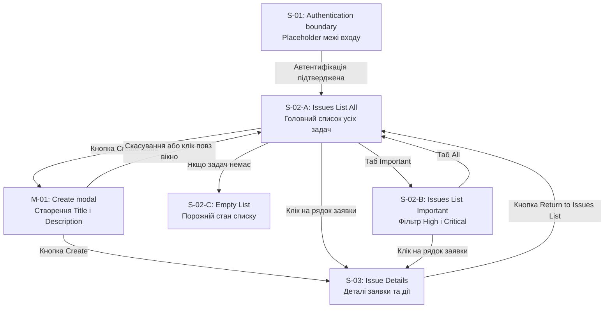

# 02 Screen Map — UX Architecture Plan (Release MVP)

**Версія:** v1.0 APPROVED  
**Статус:** ЗАТВЕРДЖЕНО (Контроль B пройдено, узгоджено з Decision Log D-01–D-08)  
**UX-архітектор:** Бєлікова Марина (NureBielikovaMaryna)  
**Дата:** 2026-10-22

---

## 1. Межі архітектури

План побудовано на основі останнього UX/UI Design Input Pack та зафіксованих у попередньому обговоренні рішень. Функціональний обсяг першого релізу — US-01–US-08. Відкладені та майбутні функції не повертаються до MVP.

Основний принцип: одна User Story не дорівнює одному екрану. Перегляд, призначення, зміна priority, зміна status і робота з comments об’єднані в спільному контексті деталей issue, а не розподілені на окремі сторінки.

> **Рішення людини (відхилений варіант ШІ):** у першій відповіді на промпт G2 ChatGPT Free запропонував винести кожну дію на окрему сторінку — окрема сторінка зміни priority, окрема сторінка comments та окремий екран призначення виконавця. Бєлікова Марина відхилила цей варіант як такий, що ускладнює користувацький досвід, і об'єднала всі ці блоки в єдиний контекстний екран деталей `S-03`, а список задач — в один екран `S-02` з трьома станами: `All` (S-02-A), `Important` (S-02-B) та `Empty` (S-02-C).

#### Погоджена структура поверхонь для цього плану

| ID | Назва | Класифікація | Призначення |
| :--- | :--- | :--- | :--- |
| S-01 | Authentication boundary | Екран-плейсхолдер | Позначає межу автентифікації без вигаданого login UI |
| S-02 | Issues List | Продуктовий екран зі станами | Перегляд спільного набору issues |
| S-02-A | All | Стан S-02 | Перегляд усіх доступних issues |
| S-02-B | Important | Стан S-02 | Перегляд Important Issues на основі тих самих даних |
| S-02-C | Empty | Стан S-02 | Порожній список |
| M-01 | Create modal | Модальне вікно | Створення issue |
| S-03 | Issue Details | Продуктовий екран | Деталі issue, призначення, priority, status і comments |

Отже, є 3 продуктові екранні поверхні та 1 модальне вікно, а також плейсхолдер межі автентифікації. Станів списку — три, але вони не є трьома незалежними продуктовими сторінками.

#### Графічна схема навігації та переходів (Screen Map Diagram)

#### Що не змінюється

* [SOURCE] Release MVP включає US-01–US-08. Джерело: Input Pack, §3 та §7; специфікація §8.
* [SOURCE] US-09 — Attach files — Deferred; SR-10 та SR-11 — Future. Джерело: Input Pack, §7; специфікація §8.
* [SOURCE] Видалення issue заборонене; окрема історія змін не передбачена. Джерело: Input Pack, §4; BR-10–BR-11.
* [SOURCE] S-01 — лише placeholder, а не погоджений екран входу. Конкретний механізм автентифікації не визначений. Джерело: BR-01, NFR-02, Q-07.
* [DERIVED] Зміна атрибута issue не повинна вимагати окремої сторінки, якщо її можна виконати в S-03. Це прямо відповідає погодженій структурі та не додає нової функціональності.

## 2. Screen / State Inventory

У таблицях позначення мають такі значення:

* SOURCE — прямо визначено специфікацією або погодженою структурою.
* DERIVED — необхідний архітектурний висновок із джерельних вимог.
* PROPOSED — пропозиція, яка потребує погодження.
* UNRESOLVED — питання без остаточного рішення.
* D-ID — ідентифікатор рішення або відкритого питання з Decision Log / цього плану. Він не підміняє вихідні ID AC чи BR.

### 2.1. S-01 — Authentication boundary

### S-01 — Authentication boundary

Placeholder

Purpose: позначити межу доступу до Mini Issue Tracker для автентифікованих членів команди.

Actors: неавтентифікований відвідувач — лише як контекст межі; автентифікований Team Member або Team Lead — після проходження цієї межі.

| Поле | Специфікація |
| :--- | :--- |
| Entry | Запит на доступ до системи без підтвердженої автентифікації; конкретний маршрут не визначено |
| Visible data | Тільки службове позначення межі автентифікації; вміст реального login UI не визначений |
| Inputs | Не визначені |
| Actions | Не визначені |
| Role/state conditions | До системи допускаються лише автентифіковані члени команди |
| Errors/empty states | Поведінка після невдалої автентифікації не визначена |
| Exit | Після підтвердження автентифікації — до S-02; точна маршрутизація потребує погодження |
| Source/D-ID | SOURCE: BR-01, NFR-02; UNRESOLVED: Q-07 |

Обмеження: не створювати поля логіна, пароля, реєстрації, відновлення пароля, SSO чи інші способи автентифікації. Вони не визначені джерелом.

### 2.2. S-02 — Issues List

### S-02 — Issues List

Screen

Purpose: переглядати доступні issues, переходити до деталей і відкривати створення нової заявки.

Actors: автентифікований Team Member, Team Lead.

| Поле | Специфікація |
| :--- | :--- |
| Entry | Після автентифікації; повернення з S-03; перемикання стану списку |
| Visible data | ID, Title, Status, Priority, Assignee, якщо призначено |
| Inputs | Вибір стану All / Important; вибір issue; команда відкриття M-01 |
| Actions | Відкрити S-03; відкрити M-01; перемкнути стан списку |
| Role/state conditions | Доступ лише для автентифікованих членів команди; права на зміну даних визначаються окремо |
| Errors/empty states | S-02-C; помилки завантаження даних потребують уточнення |
| Exit | M-01; S-03; S-01 у разі втрати автентифікованого доступу, якщо таку поведінку підтвердить реалізація |
| Source/D-ID | SOURCE: US-02, AC-02.1–AC-02.5; US-05, AC-05.1–AC-05.3; DERIVED: D-01 |

S-02-A — All

S-02-A — All

Стан екрана S-02, не окрема сторінка

Purpose: показати загальний список issues.

| Поле | Специфікація |
| :--- | :--- |
| Actors | Team Member, Team Lead |
| Entry | Початковий стан списку після входу до системи; перехід з S-02-B; повернення з S-03, якщо це рішення буде погоджено |
| Visible data | Усі доступні issues із полями ID, Title, Status, Priority, Assignee за наявності |
| Inputs | Вибір issue; вибір Important; відкриття Create modal |
| Actions | Перехід до S-03; перехід до S-02-B; відкриття M-01 |
| Role/state conditions | Права на зміну priority, assignee та status не надаються самим фактом перегляду списку |
| Errors/empty states | Якщо issues немає — S-02-C |
| Exit | S-02-B, M-01 або S-03 |
| Source/D-ID | SOURCE: US-02, AC-02.1–AC-02.3; DERIVED: D-01; UNRESOLVED: D-04 |

S-02-B — Important

S-02-B — Important

Стан того самого екрана S-02

Purpose: показати важливі issues за правилами відбору.

| Поле | Специфікація |
| :--- | :--- |
| Actors | Team Member, Team Lead |
| Entry | Перемикання зі S-02-A; повернення зі S-03, якщо погоджено збереження попереднього стану |
| Visible data | Issues з priority High або Critical та status, відмінним від Closed |
| Inputs | Вибір issue; вибір All |
| Actions | Відкрити S-03; повернутися до S-02-A |
| Role/state conditions | Low і Normal не включаються; Not Set не є встановленим рівнем; Closed виключається незалежно від priority |
| Errors/empty states | Якщо відповідних issues немає — S-02-C з контекстом Important |
| Exit | S-02-A або S-03 |
| Source/D-ID | SOURCE: US-08, AC-08.1–AC-08.4; BR-09–BR-09.1; DERIVED: D-02; UNRESOLVED: Q-02, D-04 |

Важливе архітектурне правило: Important — це фільтроване представлення того самого набору issues, а не незалежна колекція, яку потрібно створювати або зберігати окремо.

S-02-C — Empty

S-02-C — Empty

Стан екрана S-02, не окрема сторінка

Purpose: коректно відобразити відсутність записів у поточному стані списку.

| Поле | Специфікація |
| :--- | :--- |
| Actors | Team Member, Team Lead |
| Entry | S-02-A, коли issues немає; S-02-B, коли немає issues, що відповідають критеріям Important |
| Visible data | Порожній список або повідомлення про відсутність issues |
| Inputs | Перемикання All / Important; відкриття M-01 — з All, якщо дія створення доступна |
| Actions | Змінити стан списку; створити issue з All |
| Role/state conditions | Відсутність записів не змінює правил доступу |
| Errors/empty states | Це empty state, а не помилка сервера; помилка завантаження — окремий невизначений стан |
| Exit | S-02-A, S-02-B або M-01 за відповідного контексту |
| Source/D-ID | SOURCE: US-02, AC-02.5; DERIVED: D-02; UNRESOLVED: Q-18 |

Примітка: AC-02.5 дозволяє порожній список або повідомлення. Точний текст, ілюстрація чи інше оформлення порожнього стану не погоджені.

### 2.3. M-01 — Create modal

### M-01 — Create modal

Modal / overlay

Purpose: створити новий issue, не переходячи на окрему сторінку.

Actors: автентифікований Team Member або Team Lead.

| Поле | Специфікація |
| :--- | :--- |
| Entry | Команда створення зі S-02-A або S-02-C у контексті All |
| Visible data | Поля Title та Description |
| Inputs | Title; Description |
| Actions | Create; Cancel; закриття модального вікна |
| Role/state conditions | Автентифікований член команди може створювати issue |
| Errors/empty states | Порожній Title — помилка Title is required; порожній Description не допускається; інші тексти помилок не визначені |
| Exit | Успішне створення — S-03 для нового issue; Cancel — до стану S-02, з якого модальне вікно було відкрито |
| Source/D-ID | SOURCE: US-01, AC-01.1–AC-01.5; BR-02; DERIVED: D-03 |

#### Обов’язкова поведінка M-01

* [SOURCE] Title і Description обов’язкові.
* [SOURCE] Після успішного створення система задає ID, status = Open, created_at, author.
* [SOURCE] Початковий priority — Not Set.
* [DERIVED] Cancel закриває модальне вікно без створення issue.
* [DERIVED] Успішне створення відрізняється від помилки валідації; не можна переходити до S-03 як до створеної заявки, якщо операція не відбулася.

*Source: US-01, AC-01.1–AC-01.5; BR-02–BR-05.*

UNRESOLVED: поведінка після помилки мережі або сервера під час створення, а також точний текст помилки для порожнього Description. Це не слід маскувати під погоджені вимоги.

### 2.4. S-03 — Issue Details

### S-03 — Issue Details

Screen

Purpose: переглядати issue і виконувати всі дозволені операції над ним у спільному контексті.

Actors: Team Member, Team Lead; права залежать від ролі та призначення конкретного issue.

| Поле | Специфікація |
| :--- | :--- |
| Entry | Вибір issue зі S-02-A або S-02-B; успішне створення через M-01 |
| Visible data | ID, Title, Description, Status, Priority, Assignee за наявності, Author, Created at; comments з автором і часом |
| Inputs | Поле вибору Assignee; поле вибору Priority; доступні значення Status; текст нового comment |
| Actions | Перегляд issue; призначення або зміна assignee в межах визначених прав; встановлення або зміна priority; дозволений перехід status; додавання comment; повернення до списку |
| Role/state conditions | Team Lead керує Assignee та Priority; змінювати Status може лише призначений виконавець; Comment не може бути порожнім |
| Errors/empty states | Невдале збереження comment: comment не створюється, показується помилка; заборонені статусні переходи не виконуються; точні повідомлення для інших помилок не визначені |
| Exit | Назад до списку, з якого відкрито issue, за умови погодження D-04; інший вихідний маршрут не визначений |
| Source/D-ID | SOURCE: US-02–US-08; BR-06–BR-09.1; DERIVED: D-01–D-05; UNRESOLVED: Q-03–Q-05, Q-08–Q-12 |

#### Внутрішні області S-03

Це області одного екрана, а не окремі screens або модальні вікна.

| Область | Дані та контролі | Обмеження | Source |
| :--- | :--- | :--- | :--- |
| Issue summary | ID, Title, Description, Author, Created at | Не додавати непогоджені поля | US-02, AC-02.4 |
| Assignment | Поточний Assignee та контроль призначення | Лише Team Lead; один assignee з числа членів команди | US-03, 4 ненумеровані AC |
| Priority | Поточне значення, включно з Not Set | Лише Team Lead; встановлені значення Low, Normal, High, Critical | US-04; BR-04–BR-06 |
| Status | Поточний status і допустимі наступні переходи | Лише призначений виконавець; правила BR-08.1 | US-05, US-07; BR-07–BR-08.1 |
| Comments | Перелік comments і поле введення нового comment | Непорожній текст; при помилці збереження comment не створюється | US-06, AC-06.1–AC-06.5 |
| Back navigation | Повернення до попереднього списку | Збереження All/Important ще потребує рішення | D-04, Q-04 |

Архітектурний висновок: призначення, priority, status та comments не потребують самостійних сторінок. Їхні контролі й стани розміщуються в S-03, але доступність кожної дії визначається окремими бізнес-правилами.

## 3. Таблиця переходів

У колонці Preconditions наведено необхідні умови переходу. Спроба виконати заборонену дію не є переходом: стан даних і поточний екран не змінюються, окрім повідомлення про відмову, якщо воно передбачене вимогами.

### 3.1. Навігація та створення

| T-ID | From | Actor | Trigger | Preconditions | To | Visible result | Requirement / D-ID |
| :--- | :--- | :--- | :--- | :--- | :--- | :--- | :--- |
| T-01 | S-01 | Автентифікований Team Member / Team Lead | Автентифікацію підтверджено | Доступ підтверджений | S-02-A або S-02-C | Список issues або його порожній стан | BR-01; US-02; D-01. Точна початкова маршрутизація — UNRESOLVED |
| T-02 | S-02-A | Team Member / Team Lead | Натискає Create | Користувач автентифікований | M-01 | Форма створення | US-01; BR-02; D-03 |
| T-03 | S-02-C | Team Member / Team Lead | Натискає Create у контексті All | Поточний список All порожній | M-01 | Форма створення | US-01; AC-02.5; D-03 |
| T-04 | M-01 | Team Member / Team Lead | Натискає Cancel або закриває modal | Створення ще не відбулося | S-02-A або S-02-C — вихідний стан | Повернення до списку, issue не створено | DERIVED: D-03 |
| T-05 | M-01 | Team Member / Team Lead | Натискає Create | Title і Description заповнені; створення успішне | S-03 | Створена заявка з ID, Open, Not Set, Author і Created at | US-01, AC-01.1–AC-01.5; BR-03–BR-05 |
| T-06 | M-01 | Team Member / Team Lead | Натискає Create | Title порожній | M-01 | Title is required; issue не створено | US-01, AC-01.2; Gherkin-приклад |
| T-07 | M-01 | Team Member / Team Lead | Натискає Create | Description порожній | M-01 | Валідація; issue не створено. Точний текст помилки не визначено | US-01, AC-01.3; D-03 |
| T-08 | S-02-A | Team Member / Team Lead | Вибирає issue | Issue присутній у списку | S-03 | Деталі вибраної заявки | US-02, AC-02.3–AC-02.4 |
| T-09 | S-02-B | Team Member / Team Lead | Вибирає Important issue | Issue відповідає критеріям Important | S-03 | Деталі тієї самої заявки | US-08, AC-08.1–AC-08.4 |
| T-10 | S-02-A | Team Member / Team Lead | Вибирає Important | Список доступний | S-02-B або S-02-C | Відображаються High/Critical issues, крім Closed; якщо відповідних немає — empty state | US-08; BR-09.1; D-02 |
| T-11 | S-02-B | Team Member / Team Lead | Вибирає All | Список доступний | S-02-A або S-02-C | Відображається загальний список | US-02; D-02 |

Важливо: T-04 повертає до конкретного вихідного стану, а не до довільної сторінки. Після успішного створення T-05 веде до S-03, щоб користувач бачив саме створений issue. Повернення з S-03 до All або Important описано окремо, оскільки збереження походження ще не має підтвердженого статусу.

### 3.2. Призначення та priority

| T-ID | From | Actor | Trigger | Preconditions | To | Visible result | Requirement / D-ID |
| :--- | :--- | :--- | :--- | :--- | :--- | :--- | :--- |
| T-12 | S-03 | Team Lead | Вибирає assignee | Обрано одного члена команди; операція успішна | S-03 | Відображається поточний Assignee | US-03, критерії 1, 2, 4 |
| T-13 | S-03 | Team Lead | Вибирає priority | Значення Low / Normal / High / Critical; операція успішна | S-03 | Відображається новий Priority | US-04, AC-04.1–AC-04.2; BR-05–BR-06 |
| T-14 | S-03 | Team Member | Намагається призначити issue | Actor не Team Lead | Перехід відсутній | Assignee не змінюється; операція заборонена | US-03, критерій 3; D-05 |
| T-15 | S-03 | Team Member | Намагається змінити priority | Actor не Team Lead | Перехід відсутній | Priority не змінюється | US-04, AC-04.2; BR-06; D-05 |
| T-16 | S-03 | Team Lead | Намагається встановити невідомий рівень priority | Значення не входить до дозволеного переліку | Перехід відсутній | Priority не змінюється | US-04, AC-04.1; DERIVED: D-05 |
| T-17 | S-03 | Team Lead | Намагається очистити встановлений priority | Не визначено, чи дозволено Not Set після встановлення | UNRESOLVED | Не визначено | Q-03 |

Призначення та зміна priority не створюють переходу на іншу сторінку. Це операції в межах S-03.

### 3.3. Зміна статусу

| T-ID | From | Actor | Trigger | Preconditions | To | Visible result | Requirement / D-ID |
| :--- | :--- | :--- | :--- | :--- | :--- | :--- | :--- |
| T-18 | S-03, Open | Призначений виконавець | Вибирає In Progress | Actor є assignee; перехід дозволений | S-03, In Progress | Новий status | US-07, AC-07.1–AC-07.5; BR-08.1 |
| T-19 | S-03, In Progress | Призначений виконавець | Вибирає Resolved | Actor є assignee; перехід дозволений | S-03, Resolved | Новий status | US-07, AC-07.2–AC-07.5; BR-08.1 |
| T-20 | S-03, Resolved | Призначений виконавець | Вибирає Closed | Actor є assignee; перехід дозволений | S-03, Closed | Новий status; issue виключається з Important | US-07; US-08, AC-08.4; BR-08.1 |
| T-21 | S-03, Resolved | Призначений виконавець | Вибирає In Progress | Actor є assignee; дозволене повторне відкриття роботи | S-03, In Progress | Status повертається до In Progress | BR-08.1; US-07 |
| T-22 | S-03 | Team Member, який не є assignee | Намагається змінити status | Actor не є виконавцем issue | Перехід відсутній | Status не змінюється | US-07, AC-07.4 |
| T-23 | S-03, будь-який status | Призначений виконавець | Намагається виконати недозволений перехід | Перехід відсутній у BR-08.1 | Перехід відсутній | Status залишається попереднім | US-07, AC-07.5; BR-08.1 |
| T-24 | S-03, Closed | Будь-який actor | Намагається повернути issue до іншого status | Правило повторного відкриття Closed не визначено; такого дозволеного переходу немає в BR-08.1 | Перехід відсутній | Status залишається Closed | BR-08.1; Q-05 |

Після успішного переходу статус оновлюється на S-03 і має відображатися при наступному перегляді. Resolved → In Progress — дозволений шлях повторного відкриття роботи. Closed → In Progress не є дозволеним переходом у поточній специфікації.

### 3.4. Comments та Important Issues

| T-ID | From | Actor | Trigger | Preconditions | To | Visible result | Requirement / D-ID |
| :--- | :--- | :--- | :--- | :--- | :--- | :--- | :--- |
| T-25 | S-03 | Team Member / Team Lead | Додає comment | Текст непорожній; збереження успішне | S-03 | Comment показано з автором і датою/часом | US-06, AC-06.1–AC-06.4 |
| T-26 | S-03 | Team Member / Team Lead | Додає comment | Текст порожній | S-03 | Comment не створюється; валідація | US-06, AC-06.1 |
| T-27 | S-03 | Team Member / Team Lead | Додає comment | Збереження завершилося помилкою | S-03 | Comment не створено; показано помилку | US-06, AC-06.5 |
| T-28 | S-03, priority High/Critical, status ≠ Closed | Team Member / Team Lead | Повертається до Important | Issue відповідає правилам Important | S-02-B | Issue присутній у Important | US-08, AC-08.1–AC-08.2; BR-09.1 |
| T-29 | S-03, priority Low/Normal/Not Set | Team Member / Team Lead | Повертається до Important | Issue не відповідає вимозі High/Critical | S-02-B або S-02-C | Issue не показується в Important | US-08, AC-08.3; BR-04–BR-05 |
| T-30 | S-03, status Closed | Team Member / Team Lead | Повертається до Important | Issue має Closed status | S-02-B або S-02-C | Issue не показується незалежно від priority | US-08, AC-08.4 |
| T-31 | S-03 | Team Member / Team Lead | Натискає Back | Є збережений контекст попереднього стану списку | S-02-A або S-02-B | Відновлено попередній стан списку | PROPOSED: D-04; очікує підтвердження |
| T-32 | S-03 | Team Member / Team Lead | Натискає Back | Контекст попереднього стану не збережено або поведінка не погоджена | UNRESOLVED | Немає погодженого цільового стану | Q-04; D-04 |

Правило переходу T-28–T-30: після зміни статусу або priority набір Important Issues має перераховуватися за актуальними значеннями. Відображення у списку не є незалежним збереженим станом даних.

*Source: US-08, AC-08.1–AC-08.4; BR-09–BR-09.1.*

## 4. Текстові user flows для всіх MVP-сценаріїв

У кожному сценарії вказано початкову поверхню, дії, очікувані стани та негативні гілки. Відсутній у специфікації механізм не підміняється вигаданою поведінкою.

### Flow F-01 — Створення issue

Покриває: US-01.

S-01 → S-02-A → M-01 → S-03

1. Автентифікований користувач потрапляє до S-02-A.

2. Вибирає Create, відкривається M-01.

3. Вводить Title та Description.

4. Якщо обидва поля валідні й створення успішне, система створює issue з ID, Open, Not Set, Author та Created at.

5. Відкривається S-03 створеної заявки.

#### Негативні гілки:

* Порожній Title → M-01, помилка Title is required, issue не створюється.
* Порожній Description → M-01, валідація, issue не створюється.
* Cancel → повернення до попереднього стану S-02, без створення issue.
Очікуваний результат: успішне створення веде до деталей нової заявки; скасування та валідаційні помилки не створюють запис.

*Source: US-01, AC-01.1–AC-01.5; BR-02–BR-05.*

### Flow F-02 — Перегляд issue

Покриває: US-02, US-05.

S-02-A → S-03 → S-02-A (PROPOSED)

1. Користувач переглядає список у S-02-A.

2. Вибирає issue.

3. У S-03 бачить ID, Title, Description, Status, Priority, Assignee за наявності, Author і Created at.

4. Повертається до списку.

Очікуваний результат: дані issue доступні на сторінці деталей, status видимий і в списку, і в деталях.

Повернення: відновлення саме S-02-A є запропонованим рішенням D-04, а не підтвердженим бізнес-правилом.

*Source: US-02, AC-02.1–AC-02.5; US-05, AC-05.1–AC-05.3; D-04.*

### Flow F-03 — Призначення issue Team Lead

Покриває: US-03.

S-02-A → S-03 → S-03

1. Team Lead відкриває issue.

2. У S-03 вибирає одного assignee зі списку членів команди.

3. Після успішного призначення поточний assignee відображається в деталях issue.

Негативна гілка: Team Member намагається виконати призначення → перехід відсутній, Assignee не змінюється.

Очікуваний результат: призначення не веде на окремий екран і не дозволяє вибрати особу поза командою.

*Source: US-03, чотири ненумеровані AC; BR-01.*

### Flow F-04 — Встановлення або зміна priority

Покриває: US-04.

S-02-A → S-03 → S-03

1. Team Lead відкриває issue.

2. Переглядає поточний priority.

3. Вибирає Low, Normal, High або Critical.

4. Після успішної зміни бачить нове значення на S-03.

#### Негативні гілки:

* Team Member намагається змінити priority → перехід відсутній.
* Значення поза допустимим переліком → зміна не відбувається.
* Повернення встановленого priority до Not Set → не реалізується як погоджена дія, доки не закрито Q-03.
Очікуваний результат: зміна priority відбувається в S-03, без окремої сторінки налаштувань.

*Source: US-04, AC-04.1–AC-04.2; BR-04–BR-06; Q-03.*

### Flow F-05 — Дозволені статусні переходи

Покриває: US-05, US-07.

Дозволені маршрути:

* S-03 (Open) → S-03 (In Progress)
* S-03 (In Progress) → S-03 (Resolved)
* S-03 (Resolved) → S-03 (Closed)

1. Призначений виконавець відкриває issue.

2. Бачить поточний status.

3. Виконує лише дозволений наступний перехід.

4. Система зберігає та відображає новий status.

Негативна гілка: будь-який недозволений перехід → перехід відсутній, status не змінюється.

*Source: US-05, AC-05.1–AC-05.3; US-07, AC-07.1–AC-07.5; BR-08.1.*

### Flow F-06 — Повернення Resolved issue у роботу

Покриває: US-07.

S-03 (Resolved) → S-03 (In Progress)

1. Призначений виконавець відкриває issue зі статусом Resolved.

2. Вибирає дозволений перехід до In Progress.

3. Система зберігає та показує новий status.

4. Якщо issue має High або Critical priority, він залишається кандидатом для Important, оскільки не є Closed.

Очікуваний результат: Resolved не трактується як Closed; повторне відкриття роботи виконується в межах того самого S-03.

*Source: BR-08.1, BR-09.1; US-07; US-08, AC-08.1–AC-08.2.*

### Flow F-07 — Comment success

Покриває: US-06.

S-03 → S-03

1. Користувач вводить непорожній текст.

2. Надсилає comment.

3. Якщо збереження успішне, comment з’являється в контексті issue з автором та датою/часом.

Очікуваний результат: новий comment підтверджений фактичним успішним збереженням, а не лише введенням тексту.

*Source: US-06, AC-06.1–AC-06.4.*

### Flow F-08 — Comment error

Покриває: US-06.

S-03 → S-03 (error state)

1. Користувач надсилає непорожній comment.

2. Збереження завершується помилкою.

3. Система показує повідомлення про помилку.

4. Comment не додається до підтвердженого переліку.

Очікуваний результат: не створюється хибного враження, що коментар успішно опубліковано.

Невирішене: чи зберігати текст у полі після помилки та як реалізувати повторну спробу. Це Q-12, а не погоджений сценарій.

*Source: US-06, AC-06.5; Q-12.*

### Flow F-09 — Перегляд Important

Покриває: US-08.

S-02-A → S-02-B → S-03 → S-02-B (PROPOSED)

1. Користувач перемикає список на Important.

2. Система показує issues з High або Critical priority та статусом, відмінним від Closed.

3. Користувач відкриває issue в S-03.

4. Після повернення, якщо D-04 буде погоджено, відновлюється S-02-B.

Негативні умови:

* Low, Normal та Not Set не задовольняють критерій priority.
* Closed виключається незалежно від priority.
* Resolved із High або Critical залишається в Important.

*Source: US-08, AC-08.1–AC-08.4; BR-09.1; D-02; D-04.*

### Flow F-10 — Заборонена дія для неуповноваженого користувача

Покриває: права US-03, US-04, US-07.

S-03 → S-03 (без зміни даних)

1. Користувач відкриває issue.

2. Намагається виконати операцію, на яку не має права: призначити issue як Team Member, змінити priority як Team Member або змінити status, не будучи assignee.

3. Операція не виконується.

4. Поточні значення issue залишаються незмінними.

Очікуваний результат: немає переходу на іншу сторінку, немає успішного оновлення даних. Конкретний спосіб повідомлення про відмову потребує погодження, якщо він не заданий джерелом.

*Source: US-03, критерій 3; US-04, AC-04.2; US-07, AC-07.4; BR-06, BR-08.*

### Flow F-11 — Порожній список

Покриває: US-02, US-08.

Варіант All: S-02-A → S-02-C

1. Користувач відкриває список All.

2. Система не знаходить жодного issue.

3. Відображається S-02-C.

Варіант Important: S-02-B → S-02-C

1. Користувач вибирає Important.

2. Жоден issue не відповідає критеріям High/Critical та status ≠ Closed.

3. Відображається S-02-C у контексті Important.

Очікуваний результат: порожній список не є помилкою сам по собі. З All можна відкрити M-01 для створення issue; повернення до All з Important виконується перемиканням стану списку.

*Source: US-02, AC-02.5; US-08, AC-08.1–AC-08.4; Q-18.*

## 5. Figma frames: скільки потрібно для демонстрації

Кількість продуктових екранів не дорівнює кількості Figma frames. S-02 має кілька станів, а S-03 має кілька рольових і функціональних станів, які варто продемонструвати окремо.

Рекомендований мінімум для демонстрації — 8 Figma frames. Це план демонстраційних кадрів, а не вимога створювати вісім різних продуктових екранів.

| Frame ID | Назва frame | Що демонструє | Поверхня |
| :--- | :--- | :--- | :--- |
| F-01 | Authentication boundary | Placeholder межі автентифікації без login UI | S-01 |
| F-02 | Issues List — All | Список із даними | S-02-A |
| F-03 | Issues List — Important | Відфільтрований список | S-02-B |
| F-04 | Issues List — Empty | Порожній список | S-02-C |
| F-05 | Create Issue — Modal | Поля, валідація та Cancel | S-02 + M-01 |
| F-06 | Issue Details — Team Member | Перегляд issue, comments і статусні дії відповідно до прав | S-03 |
| F-07 | Issue Details — Team Lead | Призначення та зміна priority в деталях | S-03 |
| F-08 | Issue Details — Error / Status State | Помилка збереження comment та демонстрація окремого статусного стану | S-03 |

Чому саме 8

* S-01 залишається окремим демонстраційним placeholder, а не вигаданим екраном входу.
* Три стани списку потребують окремих кадрів, щоб показати All, Important та Empty.
* Create modal показується поверх контексту списку, а не як нова сторінка.
* Два рольові кадри S-03 потрібні, щоб перевірити різницю між діями Team Member і Team Lead.
* Останній кадр потрібен для демонстрації негативного сценарію збереження comment та статусної поведінки.

> **[PROPOSED]** Вісім frames — рекомендований набір для демонстрації. Це не остаточне рішення щодо кількості кадрів для всіх можливих помилок і комбінацій станів. Для перевірки повного набору AC знадобляться додаткові прототипні сценарії або варіанти станів.

## 6. Три приклади того, чого НЕ слід додавати

### 6.1. Окрема сторінка керування Priority або Assignment

Зміна priority та призначення виконавця залишаються в S-03. Перехід на окрему сторінку налаштувань не передбачений.

### 6.2. Відновлення Deferred/Future функцій

Не додавати attachments, автоматичну категоризацію або автоматичну рекомендацію priority. Вони не входять до Release MVP.

### 6.3. Типові, але не визначені можливості issue tracker

Не додавати видалення issue, окрему історію змін, редагування коментарів чи довільне повторне відкриття Closed. Відсутність цих функцій не можна компенсувати звичними UX-патернами без зміни вимог.

*Source: BR-10–BR-11; §8 Release Scope; US-06; BR-08.1.*

## 7. Мінімальний Screen Inventory

| ID | Тип | Входить до Release MVP | Призначення |
| :--- | :--- | :--- | :--- |
| S-01 | Placeholder boundary | Так, як позначення межі | Автентифікаційна межа |
| S-02 | Screen | Так | Список issues |
| S-02-A | State | Так | Усі issues |
| S-02-B | State | Так | Important issues |
| S-02-C | State | Так | Порожній список |
| M-01 | Modal / overlay | Так | Створення issue |
| S-03 | Screen | Так | Деталі issue та всі дозволені операції |

Додаткові стани помилок у M-01 і S-03 — це component/state variants, а не окремі продуктові сторінки. Службові пояснення, позначки ролей і примітки про непогоджені рішення також не є продуктовими екранами.

## 8. Unresolved рішення перед остаточним погодженням

| D-ID / Q-ID | Рішення | Поточний статус |
| :--- | :--- | :--- |
| D-04 / Q-04 | Чи зберігати попередній стан All або Important після повернення з S-03? | PROPOSED, потребує погодження |
| Q-02 | Чи залишити назву Important Open Issues, попри включення Resolved? | UNRESOLVED |
| Q-03 | Чи можна повернути встановлений priority до Not Set? | UNRESOLVED |
| Q-04 | Чи дозволено очищати або перепризначати Assignee? | UNRESOLVED |
| Q-05 | Чи є Closed остаточним статусом? | UNRESOLVED |
| Q-07 | Який механізм автентифікації реалізується? | UNRESOLVED; S-01 не деталізується |
| Q-08 | Які точні тексти помилок потрібні, крім явно заданого Title is required? | UNRESOLVED |
| Q-09 | Які формат і часовий пояс використовувати для дат? | UNRESOLVED |
| Q-12 | Що відбувається з текстом comment після помилки збереження? | UNRESOLVED |
| Q-15 | Як перевіряти NFR Response time < 1 s? | UNRESOLVED |
| Q-18 | Який саме варіант Empty state погодити? | UNRESOLVED |

Важливо: у цьому плані збереження попереднього стану списку запропоновано як навігаційну поведінку, але не оголошено погодженим рішенням. До погодження D-04 прототип має позначати цей маршрут як такий, що потребує підтвердження.

## 9. Критерії, які план ще не покриває повністю

Архітектура визначає основні маршрути, але не замінює повну перевірку вимог.

1. US-01: помилка збереження під час створення issue, крім визначених правил валідації.

2. US-02: помилка завантаження списку та деталей, форматування Created at, пошук, сортування й пагінація — якщо вони взагалі потрібні.

3. US-03: скасування призначення, очищення Assignee, перепризначення та помилка збереження призначення.

4. US-04: помилка збереження priority та поведінка при поверненні до Not Set.

5. US-05: відображення актуального status у списку після повернення з деталей.

6. US-06: точна поведінка поля comment після помилки; порожній comment; успішне збереження; формат дати/часу.

7. US-07: повна перевірка всіх дозволених і заборонених переходів, включно з Closed.

8. US-08: виключення Low, Normal, Not Set і Closed; включення Resolved з High/Critical; оновлення Important після зміни атрибутів.

9. NFR: фактична швидкодія, автентифікація, HTTPS та резервне копіювання не підтверджуються макетами.

10. Повернення до списку: збереження вихідного стану All/Important залишається пропозицією до підтвердження.

*Source: US-01–US-08, відповідні AC; BR-01–BR-11; NFR-01–NFR-04; Q-02–Q-18.*

## 10. Фінальний контроль

* Усі вісім Included US мають маршрут у межах погодженої структури.
* Створення веде з S-02 через M-01; Cancel не створює issue.
* Перегляд issue веде до S-03.
* Assignment і Priority залишаються в S-03.
* Status змінюється тільки за дозволеними переходами.
* Resolved → In Progress передбачено.
* Comment success та error мають різні результати.
* Important є фільтрованим представленням того самого набору issues.
* Empty state передбачено для All та Important.
* Заборонена дія не створює успішного переходу.
* Повернення не спрямовує користувача на довільну сторінку; збереження попереднього стану позначене як PROPOSED.
* Deferred/Future функції не повернуто до MVP.
* Не створено зображень, коду або Figma-файлу.
Статус документа: UX Architecture Plan — Draft for Review. Не погоджено.

Наступний крок — вирішити відкриті питання навігації та поведінки, після чого можна деталізувати стани компонентів і перевірити всі AC на рівні прототипу.

